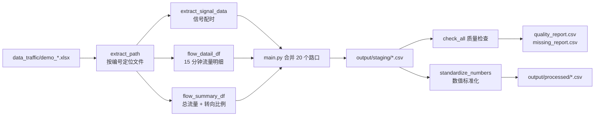

# 🚦 城市交叉口流量与信号配时数据自动化处理

<p>
  
  
  
  
  
</p>

> 一键读取 20 个交叉口的原始 Excel 报表，自动提取信号配时、15 分钟流量明细与转向比例汇总，并完成数据质量校验与数值标准化，产出可直接用于分析与建模的结构化 CSV。

---

## 📖 项目简介

交通调查原始数据通常以「一个路口一个 Excel」的形式分散保存，手工整理既耗时又容易出错。本项目把整个流程脚本化：

- **提取**：按路口编号自动定位文件，从每个 Excel 中解析「流量数据」「信号配时数据」两张工作表；
- **合并**：将 20 个路口、3 个时段的记录拼成整表；
- **质检**：自动检查重复记录、缺失值、非数值、负数、比例越界，以及「流量明细合计 ↔ 汇总总流量」的一致性；
- **标准化**：统一数值类型后输出清洗结果。

整个流程只需一条命令，运行结束即可得到完整的结果数据与质量报告。

## ✨ 功能特性

| 能力 | 说明 |
| --- | --- |
| 🗂️ 自动定位文件 | 按 `demo_<编号>流量和交叉口配时方案.xlsx` 命名规则，用路口编号找到对应文件 |
| 🚥 信号配时提取 | 读取相位级配时（绿灯、黄灯、全红、单相位总时长、周期总时长），兼容表名「信号配时数据 / 配信号时数据」 |
| ⏱️ 15 分钟流量明细 | 逐时段拆出 8 条 15 分钟统计记录，覆盖早高峰、平峰、晚高峰 |
| 📊 流量汇总与转向比例 | 按进口方向汇总总流量，并提取各转向（左转 / 直行 / 右转）比例 |
| ✅ 数据质量检查 | 重复行、缺失值、非数值、负数、比例 > 1、明细与汇总不一致等问题全部清单化输出 |
| 🔢 数值标准化 | 将流量、比例、时长类字段统一转为数值类型，缺失保持为空而不是填 0 |
| 🧩 模块化设计 | 提取、检查、编排职责分离，便于扩展新路口、新指标 |

## 🗄️ 数据说明

原始数据位于 `data_traffic/`，共 20 个交叉口（`demo_1` ~ `demo_20`）以及两份辅助表：

- `数据字典.xlsx`：字段含义说明；
- `路口基础信息表.xlsx`：路口编号与空间位置等基础信息。

每个路口 Excel 包含：

| 工作表 | 内容 |
| --- | --- |
| 流量数据 | 早高峰、平峰、晚高峰三个时段的进口道流量与转向比例，粒度 15 分钟 |
| 信号配时数据 | 各相位绿灯 / 黄灯 / 全红时长及周期总时长 |

**统计时段**

| 时段分类 | 时间范围 | 15 分钟记录数 |
| --- | --- | --- |
| 早高峰 | 7:00 – 9:00 | 8 |
| 平峰 | 14:30 – 16:30 | 8 |
| 晚高峰 | 17:30 – 19:30 | 8 |

**进口方向**：东、西、南、北、东北、东南、西南、西北，每个方向含左转 / 直行 / 右转三个流向。部分路口缺少斜向进口，对应字段保持为空（不填 0），质检阶段会作为缺失值列出。

## 🔄 处理流程



## 🚀 快速开始

### 环境要求

- Python 3.13（3.10 及以上均可运行）
- pandas、numpy、openpyxl

### 安装与运行

```powershell
# 1. 克隆仓库
git clone https://github.com/Qian-Bo-Han/data_traffic.git
cd data_traffic

# 2. 创建虚拟环境并安装依赖
python -m venv .venv
.\.venv\Scripts\Activate.ps1
pip install -r requirements.txt

# 3. 运行（必须在项目根目录执行）
python main.py
```

运行成功后会输出：

```text
开始数据质量检查
质量检查完成
发现待核实问题：N
结果已导出到output文件夹
```

## 📁 目录结构

```text
data_traffic/
├── data_traffic/              # 原始数据（20 个路口 Excel + 数据字典 + 路口基础信息表）
├── src/
│   ├── extract.py             # 数据提取：定位文件、解析流量与信号配时
│   ├── quality.py             # 数据质量检查与数值标准化
│   └── analysis.py            # 预留：后续分析模块
├── main.py                    # 主流程：循环 20 个路口 → 合并 → 质检 → 导出
├── config.py                  # 全局配置（预留）
├── requirements.txt           # 依赖清单
├── README.md
├── 函数 注释 表               # 函数职责与模块划分笔记
└── 表结构注释.png             # 输出表结构示意
```

> `output/` 目录由程序自动生成，已加入 `.gitignore`，不会被提交到仓库。

## 📤 输出结果

所有结果写入 `output/`：

| 文件 | 内容 | 主要字段 |
| --- | --- | --- |
| `staging/signal_all.csv` | 相位级信号配时 | 路口编号、时段分类、时段范围、相位编号、相位名称、绿灯/黄灯/全红/单相位/周期时长 |
| `staging/flow_detail_all.csv` | 15 分钟流量明细 | 路口编号、时段分类、统计开始/结束时间、各进口各转向流量 |
| `staging/flow_summary_all.csv` | 时段总流量与转向比例 | 路口编号、时段分类、各进口总流量、各转向比例 |
| `quality_report.csv` | 待核实问题清单 | 检查表、位置或字段、问题 |
| `missing_report.csv` | 缺失值统计 | 检查表、字段、缺失数量 |
| `processed/*.csv` | 数值标准化后的三张表 | 与 staging 相同，数值列已统一为数值类型 |

## 🧩 核心模块

| 模块 | 函数 | 职责 |
| --- | --- | --- |
| `src/extract.py` | `extract_path(excel_files, intersection)` | 根据路口编号返回对应 Excel 路径 |
| `src/extract.py` | `extract_signal_data(file_path, intersection)` | 提取单个路口的信号配时表 |
| `src/extract.py` | `flow_datail_df(file_path, intersection_id)` | 提取三个时段各 8 条 15 分钟流量明细 |
| `src/extract.py` | `flow_summary_df(file_path, intersection_id)` | 提取进口总流量与各转向比例 |
| `src/quality.py` | `check_all(signal_df, detail_df, summary_df)` | 综合质量检查，返回问题清单与缺失统计 |
| `src/quality.py` | `standardize_numbers(df)` | 将流量 / 比例 / 时长字段转为数值类型 |
| `main.py` | — | 循环调用、拼接整表、导出结果 |

## 🔍 数据质量校验规则

`check_all` 会对三张表逐项检查，问题写入 `quality_report.csv`：

1. **完全重复行**：整行重复直接记录；
2. **完整性**：每个路口每个时段应有 8 条流量明细、1 条汇总记录、至少 1 条信号配时记录；
3. **缺失值**：所有字段的 NaN 数量，仅记录不填补；
4. **数值合法性**：流量 / 比例 / 时长字段中的非数值、负数；
5. **比例范围**：转向比例大于 1 时提示核对单位；
6. **一致性**：明细表中某进口三个转向 8 条记录合计与汇总表总流量偏差超过 1 时告警。

## 🛠️ 开发约定

- `extract.py` 只负责「怎么提取数据」，`quality.py` 只负责「怎么检查数据」，`main.py` 只负责编排调用，不承载业务逻辑；
- 新增路口只需把命名规范的 Excel 放入 `data_traffic/`，无需改代码；
- 新增指标时，优先在对应模块中添加函数，再在 `main.py` 中调用。

## 🗺️ Roadmap

- [ ] 输出结果可视化（时段流量曲线、进口道流量对比）
- [ ] 一键生成 Excel 版质检报告
- [ ] 支持自定义路口编号范围与文件命名规则
- [ ] 补充单元测试与样例数据
- [ ] 提供命令行参数（数据目录、输出目录、时段筛选）

## 📄 许可证

本项目暂未附带开源许可证文件。如需对外开源，建议添加 `LICENSE`（如 MIT）并在本文件中注明。

---

<p align="center">如果这个项目对你有帮助，欢迎点一个 ⭐ Star</p>
